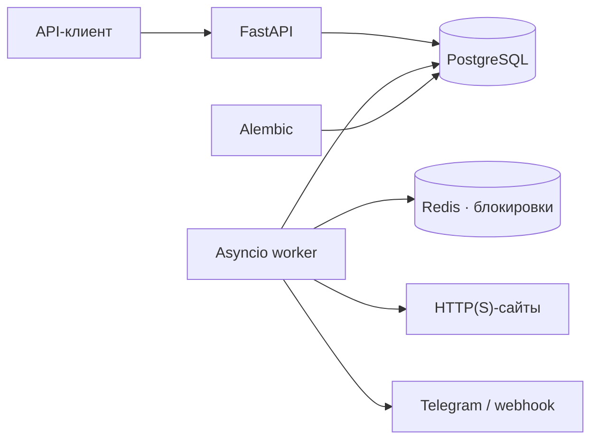

<div align="center">

# PulseWatch

**Мониторинг доступности сайтов. История проверок. Уведомления об инцидентах.**

Асинхронный сервис на FastAPI с PostgreSQL, Redis и уведомлениями через Telegram и webhook.

[](https://github.com/Strelokmonolita/PulseWatch/actions/workflows/ci.yml)
[](https://www.python.org/downloads/)
[](https://fastapi.tiangolo.com/)
[](LICENSE)

[Быстрый старт](#быстрый-старт) · [Обновление](#обновление) · [API](#api) · [Тестирование](#тестирование) · [История изменений](CHANGELOG.md)

</div>

---

## Возможности

| | Что умеет PulseWatch |
| :--- | :--- |
| **HTTP-мониторинг** | Проверки `GET`, `HEAD`, `OPTIONS` с настраиваемыми интервалом, таймаутом и ожидаемым статусом. |
| **Инциденты** | Открытие после серии сбоев, закрытие после восстановления, история событий. |
| **Уведомления** | Telegram и отдельный webhook для каждого монитора. |
| **Статистика** | История проверок, время ответа и процент доступности за последние 24 часа. |
| **Авторизация** | JWT, изоляция мониторов пользователей и одноразовая ротация refresh-токенов через БД. |
| **Фоновая работа** | Asyncio worker с продлеваемыми Redis-блокировками и проверкой их владельца. |
| **Проверка URL** | Валидация HTTP(S)-адресов и проверка целевых IP перед исходящими запросами. |

## Быстрый старт

Для запуска всего сервиса нужны **Docker** и **Docker Compose**.

### 1. Получить проект

```bash
git clone https://github.com/Strelokmonolita/PulseWatch.git
cd PulseWatch
```

### 2. Настроить окружение

<details>
<summary><strong>Windows · PowerShell</strong></summary>

```powershell
Copy-Item .env.example .env
```

</details>

<details>
<summary><strong>Linux / macOS</strong></summary>

```bash
cp .env.example .env
```

</details>

Задайте уникальный `SECRET_KEY` в `.env`. Для Telegram-уведомлений укажите
`TELEGRAM_TOKEN` и `TELEGRAM_CHAT_ID`. Остальные настройки описаны в
[разделе конфигурации](#конфигурация) и [`.env.example`](.env.example).

### 3. Запустить сервис

```bash
docker compose up --build -d
```

Compose поднимет PostgreSQL и Redis, применит миграции, затем запустит API и worker.

| Адрес | Назначение |
| :--- | :--- |
| [localhost:8000/docs](http://localhost:8000/docs) | Интерактивная документация Swagger UI |
| [localhost:8000/redoc](http://localhost:8000/redoc) | Документация ReDoc |
| [localhost:8000/health](http://localhost:8000/health) | Проверка работы API |
| [localhost:8000/health/ready](http://localhost:8000/health/ready) | Готовность API с проверкой подключения к БД |

Команды для проверки состояния и просмотра логов:

```bash
docker compose ps
docker compose logs -f api worker
```

## Обновление

Для существующей установки:

```bash
git pull --ff-only
docker compose up -d --wait db
docker compose run --rm --no-deps --build migrations alembic upgrade head
docker compose run --rm --no-deps migrations alembic current
docker compose up --build -d
```

`alembic current` должен показать актуальную ревизию с отметкой **`(head)`**.

> [!IMPORTANT]
> Миграция `a4d17f92b6c8` добавляет таблицу `refresh_tokens` для одноразовой ротации.
> Примените её перед запуском обновлённого API. Для refresh-токенов, выданных
> до этого обновления, потребуется повторный вход.

Подробности обновлений — в [CHANGELOG.md](CHANGELOG.md).

## Как это работает



1. **Worker** раз в секунду выбирает активные мониторы, для которых подошёл `interval_seconds`.
2. Перед HTTP-запросом проверяются URL и целевые IP-адреса. Редиректы не отслеживаются.
3. Результат сохраняется в `checks`. Успех — код ответа, равный `expected_status`.
4. После `INCIDENT_THRESHOLD` неудач подряд открывается инцидент и отправляется уведомление.
5. Первая успешная проверка закрывает инцидент и запускает уведомление о восстановлении.

Блокировка монитора в Redis живёт **180 секунд** и продлевается каждые **60 секунд**
до завершения задачи. Освобождение проверяет владельца; потеря блокировки отменяет проверку.
Если Redis недоступен при старте, worker работает без распределённых блокировок.
`WORKER_ENABLED=false` отключает запуск worker.

История проверок очищается согласно `HISTORY_RETENTION_DAYS` — по умолчанию через 30 дней.

<details>
<summary><strong>Проверка URL и особенности Docker / VPN</strong></summary>

Блокируются loopback, link-local, облачные metadata-адреса, RFC 1918, CGNAT,
unique-local IPv6 и служебные диапазоны. IPv4-mapped IPv6 проверяется также
по вложенному IPv4-адресу. В схемах мониторов и webhook разрешены только HTTP(S).

Диапазон `198.18.0.0/15` намеренно разрешён: Docker Desktop, VPN и прокси могут
использовать его для перехвата DNS публичных сайтов. Если в вашей сети он ведёт
во внутреннюю инфраструктуру, добавьте его в `SSRF_BLOCKED_NETWORKS`
(список CIDR через запятую).

</details>

## API

Базовый префикс — `/api`. Защищённые маршруты требуют заголовок:

```http
Authorization: Bearer <access_token>
```

Регистрация и вход доступны без access-токена. `/api/auth/refresh` принимает
refresh-токен в JSON-теле и также не требует этого заголовка.

### Авторизация

| Метод | Путь | Описание |
| :--- | :--- | :--- |
| `POST` | `/api/auth/register` | Регистрация: `username`, `email`, пароль от 8 символов |
| `POST` | `/api/auth/login` | Вход по username или email; выдача пары токенов |
| `POST` | `/api/auth/refresh` | Одноразовый обмен refresh-токена на новую пару |
| `GET` | `/api/auth/me` | Текущий пользователь |

Access-токен действует **15 минут**, refresh — **7 дней** по умолчанию.
Типы токенов невзаимозаменяемы. После успешной ротации старый refresh-токен
возвращает **401**, включая конкурентные попытки обмена. В БД хранятся SHA-256-хэши
активных refresh-токенов; состояние сохраняется между процессами и перезапусками API.

### Мониторы

| Метод | Путь | Описание |
| :--- | :--- | :--- |
| `POST` | `/api/monitors` | Создать монитор |
| `GET` | `/api/monitors?limit=&offset=` | Получить список с пагинацией |
| `GET` | `/api/monitors/{id}` | Получить монитор |
| `PATCH` | `/api/monitors/{id}` | Обновить переданные поля |
| `DELETE` | `/api/monitors/{id}` | Удалить монитор вместе с историей |
| `GET` | `/api/monitors/{id}/status` | Состояние и статистика за 24 часа |
| `GET` | `/api/monitors/{id}/checks` | История проверок монитора |

Пример тела запроса `POST /api/monitors`:

```json
{
  "name": "Основной сайт",
  "url": "https://example.com",
  "method": "GET",
  "expected_status": 200,
  "timeout_seconds": 10,
  "interval_seconds": 60
}
```

| Поле | Ограничение |
| :--- | :--- |
| `url`, `webhook_url` | Корректный HTTP(S)-адрес с допустимым портом |
| `method` | `GET`, `HEAD` или `OPTIONS` |
| `interval_seconds` | 30–86400 секунд |
| `timeout_seconds` | 1–120 секунд |
| `expected_status` | 100–599 |

Чужие мониторы возвращают **404**. В PATCH пропущенные поля сохраняют прежнее значение;
явный `null` для обязательных полей, включая `name`, возвращает **422**.
`webhook_url: null` разрешён и отключает webhook.

### История и служебные маршруты

| Метод | Путь | Описание |
| :--- | :--- | :--- |
| `GET` | `/api/checks` | Проверки пользователя; фильтры `monitor_id`, `since`, `success` |
| `GET` | `/api/incidents` | Инциденты; фильтры `monitor_id`, `status=open\|closed` |
| `GET` | `/health` | Liveness, без авторизации |
| `GET` | `/health/ready` | Readiness с проверкой БД, без авторизации |

Ответы списков: `{items, total, limit, offset}`. HTTP-ошибки имеют формат
`{detail, code}`; ошибки валидации дополнительно содержат `errors`.

## Локальная разработка

Рекомендуется **Python 3.12**, как в Docker и CI. Подготовьте доступные с хоста
PostgreSQL и Redis, скопируйте `.env.example` в `.env` и задайте строки подключения.
В основном Compose-файле порты БД и Redis доступны только внутри Docker-сети.

<details>
<summary><strong>Windows · PowerShell</strong></summary>

```powershell
py -3.12 -m venv .venv
.\.venv\Scripts\Activate.ps1
python -m pip install -e ".[dev]"
```

</details>

<details>
<summary><strong>Linux / macOS</strong></summary>

```bash
python3.12 -m venv .venv
source .venv/bin/activate
python -m pip install -e ".[dev]"
```

</details>

В активированном окружении примените миграции и запустите API:

```bash
python -m alembic upgrade head
python -m uvicorn app.main:app --reload
```

В отдельном терминале с тем же окружением запустите worker:

```bash
python -m app.worker.main
```

## Тестирование

```bash
python -m pytest
python -m ruff check .
python -m ruff format --check .
python -m mypy app
```

Pytest выводит покрытие в терминал и создаёт HTML-отчёт в `htmlcov/`.
Для быстрого локального прогона используется SQLite; Redis-тесты включаются
при заданном `REDIS_TEST_URL`.

Для интеграционных проверок экспортируйте в оболочку:

| Переменная | Назначение |
| :--- | :--- |
| `DATABASE_TEST_URL` | PostgreSQL с драйвером `postgresql+asyncpg` для проверки конкурентной ротации и отката транзакций |
| `REDIS_TEST_URL` | Тестовый Redis для проверки TTL, продления и смены владельца блокировок |

PostgreSQL-тесты создают отдельную временную схему для каждого теста.
Без `DATABASE_TEST_URL` транзакционные проверки используют временную SQLite-базу
с независимыми соединениями. Эти переменные уже настроены в
[GitHub Actions](.github/workflows/ci.yml).

## Конфигурация

Полный пример — [`.env.example`](.env.example). Основные параметры:

| Переменная | Значение по умолчанию / назначение |
| :--- | :--- |
| `DATABASE_URL` | Обязательная строка подключения SQLAlchemy с async-драйвером |
| `REDIS_URL` | Обязательная строка подключения Redis |
| `SECRET_KEY` | Обязательный ключ подписи JWT |
| `ACCESS_TOKEN_EXPIRE_MINUTES` | `15` |
| `REFRESH_TOKEN_EXPIRE_DAYS` | `7` |
| `TELEGRAM_TOKEN`, `TELEGRAM_CHAT_ID` | Вместе включают Telegram-уведомления |
| `WORKER_ENABLED` | `true`; `false` отключает worker |
| `INCIDENT_THRESHOLD` | `3` последовательные неудачные проверки |
| `HISTORY_RETENTION_DAYS` | `30` дней хранения проверок |
| `HISTORY_PRUNE_INTERVAL_SECONDS` | `3600` секунд между очистками |
| `SSRF_BLOCKED_NETWORKS` | Дополнительные запрещённые CIDR через запятую |
| `LOG_LEVEL` | `INFO` |

При локальном запуске настройки читаются из `.env` и окружения процесса.
В Docker они передаются через `environment` в [`docker-compose.yml`](docker-compose.yml).
Дополнительные параметры, например `INCIDENT_THRESHOLD` и `SSRF_BLOCKED_NETWORKS`,
для Docker следует также добавить в этот блок.

Webhook настраивается полем `webhook_url` конкретного монитора.

## Архитектура и стек

| Компонент | Технологии |
| :--- | :--- |
| API и валидация | FastAPI, Pydantic |
| Данные и миграции | PostgreSQL 16, SQLAlchemy 2, asyncpg, Alembic |
| Worker и HTTP | asyncio, HTTPX, Redis 7 |
| Авторизация | Argon2, JWT, одноразовые refresh-токены |
| Проверки качества | pytest, pytest-asyncio, Ruff, mypy в strict-режиме |

```text
app/
├── api/            # Роутеры FastAPI и зависимости
├── services/       # Бизнес-логика
├── repositories/   # Доступ к данным и атомарная ротация токенов
├── models/         # Модели SQLAlchemy
├── schemas/        # Схемы Pydantic
├── core/           # Конфигурация, БД, JWT, SSRF и логирование
├── worker/         # Планировщик и Redis-блокировки
└── notifications/  # Telegram и webhook
migrations/         # Миграции Alembic
tests/              # API, регрессионные и интеграционные тесты
.github/workflows/  # CI
```

## Лицензия

[MIT](LICENSE) · [Strelokmonolita](https://github.com/Strelokmonolita)
